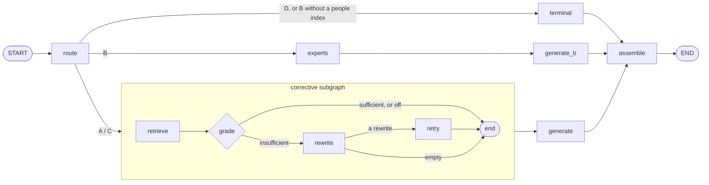

# P5-7 — LangGraph orchestration, the corrective loop, `Send`, the Functional API: the evidence

Phase 5 plan §3.7. The tests, the replay check and the overhead
measurement make zero calls. Six full sweeps ran live on NIM at commit
`4c7823f`, 2026-11-08/09; the all-lc ERROR rows were re-run alone at the
same commit (§3.4). Reproduce with:

```sh
pytest tests/test_lc_graph.py tests/test_lc_corrective.py tests/test_lc_retrieval.py \
       tests/test_langsmith_redaction.py tests/test_cli.py -q
python -m evals.orchestration_overhead --runs 2000
python -m evals.replay --out tests/fixtures/replay/native-nim.json   # re-record (live, ~155 calls)

# lc-defaults (the new default) and native, then one variant per sweep on top of lc-defaults
tessera eval --check --stack lc     --workers 1 --json evals/baselines/p5-7-lc-defaults.json
tessera eval --check --stack native --workers 1 --json evals/baselines/p5-7-native.json
TESSERA_LC_CORRECTIVE=score            tessera eval --check --stack lc --workers 1 --json evals/baselines/p5-7-lc-corrective-score.json
TESSERA_LC_CORRECTIVE=llm              tessera eval --check --stack lc --workers 1 --json evals/baselines/p5-7-lc-corrective-llm.json
TESSERA_LC_RETRIEVER=multiquery_send   tessera eval --check --stack lc --workers 1 --json evals/baselines/p5-7-lc-multiquery-send.json

# all-lc: every switch on LangChain; the LangChain splitter needs its own index
TESSERA_LC_SPLITTER=lc tessera ingest --stack lc
TESSERA_LC_{LOADER,SPLITTER,EMBEDDINGS,STORE,INDEXING,RETRIEVER,ROUTER,PROMPT_CHAIN,MODEL_CLIENT,RETRY,EXPERTISE}=lc \
TESSERA_LC_ORCHESTRATION=graph TESSERA_LC_CORRECTIVE=off \
  tessera eval --check --stack lc --workers 1 --json evals/baselines/p5-7-all-lc.json
tessera ingest --stack lc            # restore the lc-defaults index

F="evals/baselines/p5-{0-native-1,0-native-2,2-native,3-native,4-native,5-native,6-native,7-native}.json"
python -m evals.compare_sweeps evals/baselines/p5-7-native.json \
    evals/baselines/p5-7-{lc-defaults,all-lc}.json --floor-from $F --out evals/reports/p5-7-orchestration.json
python -m evals.compare_sweeps evals/baselines/p5-7-lc-defaults.json \
    evals/baselines/p5-7-lc-{corrective-score,corrective-llm,multiquery-send}.json \
    --floor-from $F --out evals/reports/p5-7-variants-vs-lc-defaults.json
python -m evals.compare_sweeps evals/baselines/p5-5-lc-multiquery.json \
    evals/baselines/p5-7-lc-multiquery-send.json --floor-from $F --out evals/reports/p5-7-send-vs-classic.json

TESSERA_LC_RETRY=lc python -m evals.ttft \
    --cases ql001,ql003,ql005,ql008,ql011,ql013,ql016,ql027,ql034,ql037 --json evals/reports/p5-7-ttft.json
```

(`F` is written for bash brace expansion; in zsh, list the files.)

## 1. The design



- **The orchestrator** (`src/tessera/lc/graph.py`) is a `StateGraph`
  over a plain-data `GraphState`. Every dependency (models, embedder,
  stores, the step functions, the switches) arrives per invocation in a
  frozen `GraphContext` through LangGraph's runtime context, never in
  state and never bound when the graph is built. The graph is compiled
  once, at import, **without a checkpointer** (a test asserts it).
- **Append reducers.** `retrievals` and the four usage lists
  (`routing_usage`, `retrieval_usage`, `corrective_usage`,
  `generation_usage`) are `Annotated[list, operator.add]`, so every
  retrieval attempt is kept — the leak checks read all of them — and
  every call is counted. `assemble` merges usage in a fixed order
  (routing, retrieval and corrective, generation), so a run's usage is
  the same as native's call for call.
- **The corrective loop** (`src/tessera/lc/corrective.py`) is a compiled
  subgraph used as the `documents` node. The `corrective` switch selects:
  - `off` — retrieve once; no grading call (equivalent to native);
  - `score` — deterministic: insufficient when the top cosine is below
    `WEAK_TOP_SCORE` (0.45) or fewer chunks were shown than `MIN_SHOWN`
    (A: 1, C: 2). No model call;
  - `llm` — the routing model returns `{"sufficient", "reasoning"}`;
    an unreadable verdict counts as sufficient (no retry on noise).

  On "insufficient" the routing model rewrites the question and retrieval
  runs **once** more through the same principal-bound retriever. The
  answer is generated for the **original** question over the retry's
  context. Grading and rewriting are metered like every other call.
- **`Send` multi-query** (`src/tessera/lc/multiquery.py`), the
  `multiquery_send` value of the `retriever` switch: `rephrase` → one
  `Send("search", …)` per query, run in parallel → `reduce` (hits in query
  order, cosine re-score in scope, then the shared
  `retrieve_from_candidates`). Every `search` goes through a `ScopedStore`
  bound to the asking principal. Unlike P5-5's `MultiQueryRetriever`, the
  rephrasing call is metered.
- **The Functional API** (`src/tessera/lc/functional.py`): the same node
  functions as `@task`s under one `@entrypoint(context_schema=GraphContext)`;
  the corrective loop is a plain Python `if`. `TESSERA_LC_ORCHESTRATION`
  selects `native`, `graph` (the default) or `functional`.
- **Four stream modes** (`stream_run`): `values` (the final state, from
  which the `PipelineRun` is read), `updates` (per-node wall time),
  `messages` (answer tokens, for time to first token) and `custom`
  (progress events — `routed`, `retrieved`, `graded`, `answered` — that
  carry stages and counts only, never content). `subgraphs=True` lets the
  subgraph's custom events through; values and updates are read from the
  top level only.

None of it uses agents or tools: no `create_agent`, `langgraph.prebuilt`,
`ToolNode` or `add_messages`.

## 2. Zero-call evidence

| Check | Tests | Result |
|---|---|---|
| **Equivalence on fakes**: the graph and the Functional API give native's `PipelineRun` (`==`) on 7 paths (A, C, B, B without people index, D, nothing relevant, routing error) × 3 principals | `tests/test_lc_graph.py::test_the_graph_equals_native_on_every_path`, `test_metered_router_and_answer_clients_stay_apart`, `test_a_routing_error_propagates_the_same_way`, `test_steps_are_injected_per_invocation_like_native` | identical, both flows |
| **Concurrency**: two invocations held at a barrier keep their usage apart; one pipeline answers two questions at once | `test_two_concurrent_invocations_keep_their_usage_apart`, `test_one_pipeline_answers_two_questions_at_once` | isolated |
| **No checkpointer, plain state** | `test_neither_flow_has_a_checkpointer`, `test_state_holds_plain_data_only` | pass |
| **Equivalence on replay**: native's recorded NIM responses (155, keyed by sha256 of system, user, temperature) replayed through both flows over exact-search Chroma indexes (`search_ef=2000`) | `test_replay_of_native_responses_is_exact_on_every_case` | **exact on all 92 cases**, both flows |
| **Streaming**: the streamed run equals the invoked one; `updates` times every node in order; `messages` streams tokens and times the first; a native model client streams none; `custom` carries stages and counts only | `test_streaming_gives_the_same_run_as_invoking`, `test_updates_time_every_node_in_order`, `test_messages_stream_tokens_and_time_the_first_one`, `test_a_native_model_client_streams_no_tokens`, `test_custom_progress_reports_stages_and_counts_only` | pass |
| **The corrective loop**: both graders, the verdict parser, `off` makes no call and equals native, one retry at most, an empty rewrite does not retry, the routing model grades and rewrites, the loop never runs outside the documents path | `tests/test_lc_corrective.py` (9 tests, both flows) | pass |
| **Scope binding extended to the loop and `Send`**: a forced retry keeps the permission filter on every store query, over 6 retriever kinds × 3 principals; every `Send` search carries it; `multiquery_send` in the walls leak test | `tests/test_lc_retrieval.py::test_the_corrective_loop_keeps_the_scope_on_its_retry`, `test_every_send_search_carries_the_permission_filter`, the leak test's `multiquery_send` row | 0 unfiltered queries, 0 leaks |
| **`Send` parity and metering**: with the same rephrasings it returns what `MultiQueryRetriever` returns; the rephrasing call is metered | `test_send_multiquery_equals_the_classic_multiquery_retriever`, `test_send_multiquery_meters_its_rephrasing_call` | identical; metered |
| **Redaction of graph runs and streamed events**, through a real `langsmith.Client` | `tests/test_langsmith_redaction.py::test_langgraph_runs_are_redacted_too`, `test_streamed_graph_runs_and_token_events_are_redacted_too` | 0 leaks, both flows |
| **The control**: without redaction, graph node runs **do** carry restricted state | `test_graph_node_runs_carry_restricted_state_without_redaction` | leaks, as expected — the graph is a new surface and redaction covers it |
| **CLI guards**: `corrective` and `multiquery_send` need `graph` or `functional` (exit 2) | `tests/test_cli.py` | pass |

Full suite at `4c7823f`: **741 passed, 8 skipped, 1 xfailed** (18 min 51 s;
610 before P5-7).

### 2.1 Orchestration overhead

`python -m evals.orchestration_overhead --runs 2000` — every model call
and store query faked, so only orchestration is timed:

| Path | Orchestrator | Median | p95 | Overhead (median) |
|---|---|---|---|---|
| A (route, retrieve, generate) | native | 0.047 ms | 0.074 ms | — |
| | graph | 3.524 ms | 3.917 ms | +3.48 ms |
| | functional | 4.510 ms | 7.973 ms | +4.46 ms |
| D (route, terminal) | native | 0.018 ms | 0.020 ms | — |
| | graph | 1.784 ms | 1.987 ms | +1.77 ms |
| | functional | 2.175 ms | 3.010 ms | +2.16 ms |

A few milliseconds against answers that take 18–66 s (§3): negligible.

### 2.2 Retrieval-only probe of the score grader

Before the sweeps, the score grader's signal was checked offline (top
cosine per A/C case against recall). Top cosine does **not** separate
partial-recall cases (`ql039` 0.660, `ql034` 0.604, `q005` 0.556) from
full-recall ones (as low as 0.416). The prediction: the score grader
would fire mostly on cases that did not need it and help little. §3.2
confirms it.

## 3. The live sweeps

All six at `4c7823f`, NIM, `--workers 1`. Every one `=> PASS (gated thresholds)`.

| Sweep | Scored | ERROR | Routing | Recall (A/C) | MRR | Ground. | Relev. | B relev. | Auth. recall | Leaks | Median latency |
|---|---|---|---|---|---|---|---|---|---|---|---|
| `native` | 92 | 0 | 100% | 0.96 | 0.97 | 4.95 | 4.95 | 4.78 | 0.92 | 0/13 | 62.9 s |
| **`lc-defaults`** (graph) | 92 | 0 | 100% | 0.96 | 0.97 | 4.98 | 4.95 | 4.89 | 1.00 | 0/13 | 65.9 s |
| `corrective=score` | 92 | 0 | 100% | 0.97 | 0.98 | 4.98 | 4.91 | 4.78 | 0.92 | 0/13 | 65.3 s |
| `corrective=llm` | 92 | 0 | 100% | 0.97 | 0.97 | 5.00 | 4.95 | 4.78 | 0.92 | 0/13 | 98.4 s |
| `multiquery_send` | 92 | 0 | 100% | 0.96 | 0.97 | 4.95 | 4.95 | 4.78 | 0.92 | 0/13 | 17.8 s |
| `all-lc` | 74 | 18 | 100% | 0.95 | 0.96 | 5.00 | 5.00 | 4.78 | 1.00 | 0/13 | 23.0 s |

**Latency is not comparable across nights.** The first four sweeps ran
overnight 2026-11-08/09 while NIM throttled hard (31–49 throttled calls
each; the pacer sat at its 30 s ceiling). `multiquery_send` and `all-lc`
ran on the evening of 2026-11-09 with no throttling. Within a night the
comparison holds: `corrective=llm` against `lc-defaults` is a real +49%.
(`multiquery_send` also ran once before, overnight, and was stopped at case
84/92 when the machine ran low on memory; that run wrote no export.)

### 3.1 `lc-defaults` (the LangGraph orchestrator) against native

`compare_sweeps`, noise floor from 8 native sweeps (A/C relevance ±0.03,
B relevance ±0.12, A/C groundedness ±0.06):

| Against `p5-7-native` | Scored in both | Routing Δ | Docs Δ | A/C ground. | A/C relev. | B relev. | Outside floor |
|---|---|---|---|---|---|---|---|
| `p5-7-lc-defaults` | 92 | 2 | 2 | 4.95→4.98 | 4.95→4.95 | 4.78→4.89 | **none** |
| `p5-7-all-lc` | 74 | 2 | 19 | 4.97→5.00 | 4.97→5.00 | 4.78→4.78 | **none** |

The two routing differences are `ac-l06` and `ac-a06`, the two
borderline lookup-or-comparative questions that flip between any two
sweeps; `ac-a06` is also why authorized recall reads 1.00 instead of 0.92
(when it routes to A it is scored; as D it is not). With replay already
exact (§2), the live sweep confirms the orchestrator adds nothing to the
answers but run-to-run model noise.

### 3.2 The corrective variants against `lc-defaults`

| Against `p5-7-lc-defaults` | Loop fired | Recall Δ | A/C ground. | A/C relev. | Input tokens | Median latency | Outside floor |
|---|---|---|---|---|---|---|---|
| `corrective=score` | 14 / 92 (A 12, C 2) | 0.96→0.97 | 4.98→4.98 | 4.95→**4.91** | +1% | 65.9→65.3 s | **A/C relevance** |
| `corrective=llm` | 30 / 92 (A 23, C 7) | 0.96→0.97 | 4.98→5.00 | 4.95→4.95 | **+52%** | 65.9→**98.4 s** | none |

"Loop fired" counts cases with `retrieval_attempts > 1` (the new
`CaseResult` field).

- **Recall moved on one case in each**: `ql011` 0.8 → 1.0. The rest of the
  0.01 is rounding.
- **Where it fired.** Most firings are on the access-control cases
  (`ac-l*`, `ac-i*`): the asking person is not cleared for the restricted
  document, so the in-scope context is thin **by design**, and no rewrite
  can fix that. The LLM grader also fires on all seven freshness cases
  (`fr*`). These are the cases the probe predicted.
- **The retry stays in scope, live.** 14 and 30 extra retrievals,
  mostly on cases built to tempt a leak: 0/13 leaks in both sweeps.
- **The score grader is slightly worse.** A/C relevance falls 0.04, just
  outside the ±0.03 floor, mostly from `ql011` (5 → 3): the retry found
  the missing document, but the answer over the new context was judged
  less relevant.
- **The LLM grader costs a lot for nothing.** One grading call on every
  documents-path question, plus a rewrite and a second retrieval on a
  third of them: +52% input tokens and +49% median latency, with judge
  scores inside the floor.

### 3.3 `Send` multi-query against the classic `MultiQueryRetriever`

| Against `p5-5-lc-multiquery` | Scored in both | Routing Δ | Docs Δ | Recall/RR Δ | A/C ground. | A/C relev. | Outside floor |
|---|---|---|---|---|---|---|---|
| `p5-7-lc-multiquery-send` | 91 | 0 | 1 (`ql013`) | 0 | 4.98→4.95 | 4.95→4.95 | **none** |

Against `lc-defaults` it is also inside the floor everywhere. The two
retrieve the same documents (one case differs, from a different
rephrasing on a live model). What `Send` adds is parallel searches and a
metered rephrasing call: input tokens 176,066 → 184,658 (+4.9%) against
P5-5's sweep, the rephrasing tokens its retriever never reported.

### 3.4 `all-lc` and its ERROR rows

`all-lc` is every switch on LangChain at once: loader, splitter (its own
index), embeddings, store, indexing, retriever, router, prompt chain,
model client, **retry**, expertise, graph orchestration, corrective off.
It passes every gated row on its 74 scored cases. 18 cases are ERROR rows
in the committed export, as the convention requires:

- **14 × `400 unknown field guided_json`.** With `retry=lc` the router is
  `ChatNVIDIA.with_structured_output(RouteDecision, method="json_schema")`
  called directly; `ChatNVIDIA` ignores `method` and sends NVIDIA's
  `guided_json` extension. Some NIM backends now reject that field; others
  accept it. A six-call probe right after the sweep succeeded six times.
  No other sweep can hit it: with `retry=native` the router goes through
  the native port and uses prompt-instructed JSON. **This is a new,
  intermittent provider-side incompatibility, not a Tessera bug** — but
  it is a real risk for any all-LangChain configuration (§5).
- **4 × `429 Too Many Requests`** after `.with_retry()` gave up. It does
  not read `Retry-After` (known since P5-6, §4 of that report).

**Re-runs** (`tessera eval --cases …` at `4c7823f` with the all-lc
switches, on the all-lc index; never merged into the export). Round 1
re-ran all 18: 14 scored, 4 hit `guided_json` again. Round 2 re-ran those
4: all scored.

| Case | Round | Expected → routed | Recall | RR | Ground. | Relev. | Other | Leaked |
|---|---|---|---|---|---|---|---|---|
| ac-a03 | 1 | A → A | 1.0 | 1.0 | — | — | | none |
| ac-a04 | 1 | A → A | 1.0 | 1.0 | — | — | | none |
| ac-a05 | 2 | A → A | 1.0 | 1.0 | — | — | | none |
| ac-a07 | 1 | A → A | 1.0 | 1.0 | — | — | | none |
| ac-a10 | 1 | A → A | 1.0 | 1.0 | — | — | | none |
| ac-i01 | 2 | A → A | — | — | — | — | injection contract held | none |
| ac-l11 | 1 | A → A | — | — | — | — | | none |
| fb001 | 2 | A → A | 1.0 | 1.0 | 5 | 5 | | none |
| nm005 | 2 | B → B | — | — | — | — | correct no-match refusal | none |
| ql004 | 1 | A → A | 1.0 | 1.0 | 4 | 4 | | none |
| ql006 | 1 | A → A | 1.0 | 1.0 | 5 | 5 | | none |
| ql007 | 1 | A → A | 1.0 | 1.0 | 5 | 5 | | none |
| ql014 | 1 | C → C | 1.0 | 1.0 | 5 | 5 | | none |
| ql024 | 1 | D → D | — | — | — | — | | none |
| ql026 | 1 | A → A | 1.0 | 1.0 | 5 | 5 | | none |
| ql027 | 1 | A → A | 1.0 | 1.0 | 5 | 5 | | none |
| ql028 | 1 | A → A | 1.0 | 1.0 | 5 | 5 | | none |
| ql035 | 1 | C → C | 1.0 | 1.0 | 5 | 5 | | none |

Every re-run routes correctly, finds every expected document, and leaks
nothing. So when it reaches the model, all-lc answers as well as native.

## 4. Time to first token

`TESSERA_LC_RETRY=lc python -m evals.ttft` over 10 A/C cases
(`evals/reports/p5-7-ttft.json`), through `stream_run` on the
`lc-defaults` index, evening of 2026-11-09:

| Case | Arch. | First token | Total | `generate` node | Tokens |
|---|---|---|---|---|---|
| ql001 | A | 5.11 s | 17.29 s | 12.10 s | 81 |
| ql003 | A | 5.08 s | 30.38 s | 24.58 s | 139 |
| ql005 | A | 20.98 s | 33.98 s | 12.92 s | 63 |
| ql008 | A | 8.28 s | 33.01 s | 24.13 s | 87 |
| ql011 | C | 7.88 s | 43.88 s | 35.82 s | 99 |
| ql013 | C | 2.89 s | 24.99 s | 21.99 s | 142 |
| ql016 | C | 2.73 s | 18.22 s | 15.43 s | 111 |
| ql027 | A | 5.49 s | 62.10 s | 56.54 s | 138 |
| ql034 | C | 4.83 s | 55.71 s | 50.82 s | 221 |
| ql037 | C | 3.41 s | 23.88 s | 20.39 s | 124 |
| **median** | | **5.09 s** | **31.69 s** | | |

Streaming shows the first words about **six times sooner** than the whole
answer (5.1 s against 31.7 s, median). The first attempt at this run
failed at the `route` node on the same `guided_json` 400 as §3.4.

**The streaming finding.** Tokens stream only when the answer chain calls
the LangChain chat model directly, which needs `retry=lc`. Under
`lc-defaults` (`retry=native`) the chain goes through the native port,
which returns the whole answer at once, so `messages` yields nothing
(`test_a_native_model_client_streams_no_tokens` pins this). The Phase 6
chat UI wants streaming, so it must either run with `retry=lc` — and so
meet the `guided_json` and `Retry-After` gaps — or give the native port a
streaming method. That choice belongs to P5-10.

## 5. Findings worth knowing

1. **The graph is a new leak surface.** LangGraph traces every node with
   its input and output state, and state carries retrieved restricted
   text. The control test shows the leak without redaction; the redacting
   client covers it (and the streamed token events). Any new node is
   covered automatically, because redaction works on the run tree, not
   per node.
2. **Append reducers are what make the loop auditable.** Without
   `operator.add` on `retrievals`, a retry would overwrite the first
   attempt, and the leak check would only see the last one.
3. **`subgraphs=True` is needed for custom events from a subgraph**, and
   then values and updates must be filtered to the top-level namespace,
   or the subgraph's own state snapshots look like the run's.
4. **`guided_json` on NIM is intermittent** (§3.4). Options for P5-10:
   route on the chat model with prompt-instructed JSON (native's way),
   treat this 400 as retryable, or keep the router on `retry=native`.
5. **Corrective RAG does not suit this corpus.** Retrieval already has
   0.96 recall with no total misses. The cases where context is thin are
   thin because of permissions, which no rewrite can or should get round.

## 6. Graph or Functional API

| | `StateGraph` (graph) | `@entrypoint` / `@task` (functional) |
|---|---|---|
| Equivalence (fakes, replay) | exact | exact |
| Overhead (A path, median) | +3.48 ms | +4.46 ms |
| Control flow | edges and conditional edges, visible in the drawn graph | plain Python `if` / calls |
| The corrective loop | a compiled subgraph, reusable as a node | an inline `if`; no separate unit |
| Streaming | all four modes measured (`stream_run`, §4) | not measured here; `stream_run` uses the graph |
| Traces | one run per node, named; the subgraph nested | one run per task; both redacted (§2) |
| Reads best for | branching flows that a reviewer should see as a diagram | short linear flows |

Both are pure over plain data and take their dependencies from runtime
context. The graph is slightly faster, draws itself (the diagram in §1 is
the real topology), and keeps the loop as its own testable unit. The
Functional API is shorter to write and easier to step through in a
debugger.

### 6.1 The same decision in two idioms: `RunnableBranch` and conditional edges

P5-6's LCEL chain picks the prompt with a `RunnableBranch`
(`lambda x: x["archetype"] is Archetype.LOOKUP` → lookup prompt, else
synthesis; `src/tessera/lc/generation.py`). P5-7's graph picks the path
with a conditional edge on the same routing decision (`after_route` →
`terminal` | `experts` | `documents`; `src/tessera/lc/graph.py`).

| | `RunnableBranch` | Conditional edge |
|---|---|---|
| Decides | which Runnable runs next inside one chain | which node runs next in the graph |
| Branches | (condition, Runnable) pairs tried in order, plus a default | a function returning a node name; the names are declared |
| State | the chain's input dict only | the whole graph state |
| Shows up as | one `RunnableBranch` run with the chosen child | an edge in the drawn graph; the next node's run |
| Fits | a local choice inside one step (which prompt) | the shape of the whole flow (which path) |

Tessera uses both, each where it fits: the prompt choice is local to
generation, so it stays a `RunnableBranch`; the archetype path decides
which steps run at all, so it is an edge.

## 7. Decision

- **Orchestration default: `graph`** (`TESSERA_LC_ORCHESTRATION=graph`),
  under `lc-defaults`. It passes every gated row, is inside the noise
  floor against native, and replays native exactly. `functional` stays
  selectable as the comparison.
- **Corrective default: `off`.** Neither grader improves answers on this
  corpus: `score` is slightly worse on A/C relevance, and `llm` costs
  +52% input tokens and +49% latency for no gain. The loop stays built and
  tested, and the switch stays for a corpus where retrieval misses.
- **`multiquery_send`** stays a `retriever` value beside P5-5's classic
  multi-query. It matches the classic retriever's quality and meters the
  rephrasing call. It is not the default: `lc-defaults` keeps the native
  retriever, which equals it in quality with one model call less.
- **Carried to P5-10:** the `guided_json` incompatibility (§5.4) and the
  streaming question (§4) both bear on choosing `retry=lc`.
- **LangGraph's `RetryPolicy`** was added after the first P5-7 PR, as the
  `retry` switch's `graph` value (§8). It stays an option, not the
  default.

## 8. LangGraph's `RetryPolicy` (`retry=graph`)

Added in a follow-up commit (`000b761`). Plan §3.6 lists it as the third
LangChain-family retry mechanism to set against the native
`RetryingLLMClient`; P5-6 deferred it to P5-7.

```sh
pytest tests/test_lc_graph_retry.py tests/test_cli.py -q
TESSERA_LC_RETRY=graph tessera eval --check --stack lc --workers 1 --json evals/baselines/p5-7-lc-retry-graph.json
tessera eval --check --stack lc     --workers 1 --json evals/baselines/p5-7-lc-defaults-2.json
tessera eval --check --stack native --workers 1 --json evals/baselines/p5-7-native-2.json
python -m evals.compare_sweeps evals/baselines/p5-7-lc-defaults-2.json \
    evals/baselines/p5-7-lc-retry-graph.json evals/baselines/p5-6-lc-retry.json \
    --floor-from evals/baselines/p5-{0-native-1,0-native-2,2-native,3-native,4-native,5-native,6-native,7-native,7-native-2}.json \
    --out evals/reports/p5-7-retry-graph.json
```

### 8.1 Design

- **Where the retry lives.** `retry=native` retries inside the client
  (`RetryingLLMClient`); `retry=lc` wraps the chat model in
  `.with_retry()`; `retry=graph` retries **the node**. A
  `RetryPolicy` sits on every node that calls a model — `route`,
  `generate`, `generate_b`, and the corrective subgraph's `retrieve`
  (the `Send` multi-query rephrases), `grade`, `rewrite` and `retry` —
  and on nothing else.
- **A second compiled graph.** `GRAPH_WITH_RETRIES = build_graph(GRAPH_RETRY_POLICY)`.
  The default `GRAPH` has no policy, so under `retry=lc` a call that
  `.with_retry()` already gave up on is not retried a second time.
  `LangGraphPipeline(graph=...)` picks one; the composition root passes
  `GRAPH_WITH_RETRIES` only for `retry=graph`.
- **Errors stay readable.** The chat models are called directly (as with
  `retry=lc`) and their errors translated (`translated()`, factored out of
  `with_lc_retries`), so `is_transient` reads a status the way the native
  layer does: 429 or 5xx.
- **Schedule.** The native layer's 5xx schedule: 15 s, doubling, 120 s
  cap, 6 attempts, with jitter. Pacing is `retry=lc`'s
  `InMemoryRateLimiter`.

| | `RetryingLLMClient` (native) | `.with_retry()` (lc) | `RetryPolicy` (graph) |
|---|---|---|---|
| Unit retried | one model call | one model call | the whole node |
| `Retry-After` honoured | yes | no | no |
| 429 vs 5xx schedule | 45 s vs 15 s base | one schedule | one schedule |
| Waits shared across callers | yes (`Pacer` cool-down) | no | no |
| Failed attempt's side effects | none to undo | none to undo | the node's writes dropped by LangGraph |
| Configured | per client | per runnable | per node, at compile time |

### 8.2 Zero-call evidence

`tests/test_lc_graph_retry.py` (15 tests) plus 4 in `tests/test_cli.py`,
with scripted clients raising `LLMCallError` with a status and a policy
with no waits:

| Check | Result |
|---|---|
| A 503 and a 429 on routing, a 502 on the answer, on the A, C and B paths: the run **equals a clean native run** (`==`: answer, citations, trace, usage) | pass — a failed attempt leaves nothing behind |
| The corrective grader and rewriter each fail once (`corrective=llm`) | pass — still exactly two retrieval attempts |
| A 400 | raised at once, one call |
| Six 503s | gives up after six calls |
| The default `GRAPH` | raises on the first 503 (no policy) |
| Which nodes carry the policy | exactly the seven model-calling nodes |
| `LcModel(retries=False)` | errors translated (`TransientLLMError`, status 503), not retried |
| CLI | `retry=graph` needs `model_client=lc` and `orchestration=graph` (exit 2); it builds bare `LangChainLLMClient`s with the rate limiter, and runs `GRAPH_WITH_RETRIES` |

Full suite at `000b761`: **761 passed, 8 skipped, 1 xfailed**.

### 8.3 The live sweeps

At `000b761`, NIM, `--workers 1`, 2026-11-12. All three `=> PASS (gated thresholds)`.

| Sweep | Scored / ERROR | Throttled (judge) | Recall | MRR | Ground. | Relev. | Median latency |
|---|---|---|---|---|---|---|---|
| `native-2` | 92 / 0 | 0 | 0.96 | 0.97 | 4.98 | 4.98 | 9.9 s |
| `lc-defaults-2` | 92 / 0 | 0 | 0.96 | 0.97 | 4.98 | 4.98 | 8.5 s |
| `lc-retry-graph` | 92 / 0 | 0 | 0.96 | 0.97 | 4.95 | 4.91 | 8.2 s |

Against `lc-defaults-2` (floor now from 9 native sweeps: A/C relevance
±0.05), `retry=graph` is inside the floor everywhere except **A/C
relevance, −0.07**. Three cases, each with **the same retrieved
documents** in both sweeps: `ql004` 5→4, `ql011` 4→3, `ql017` 5→4 — the
answers are worded differently and the judge marks one detail missing.
These are the cases that move between any two sweeps (`ql017` was the
P5-6 router dip, `ql011` the corrective-score one). P5-6's `retry=lc`
sweep shows the same kind of dip (4.98→4.93), and both are the configs in
which the answer chain calls `ChatNVIDIA` directly. The retry layer itself
cannot be the cause: NIM was calm all day (0 throttled calls in all three
sweeps, 17–19 min each), so the policy almost certainly never fired.

**What this does not show.** The export counts the judge's throttled
calls, not the answer pipeline's retries, so no sweep can show how often
the `RetryPolicy` fired, and a calm day can't rank it against the other
two layers. The fault-injection tests are the evidence for its behaviour;
the sweep is the evidence that it changes nothing when nothing fails.

### 8.4 Decision

`retry` stays `native` in `lc-defaults`. `RetryPolicy` is the cleanest
retry of the three on a failure inside a node — the failed attempt's
writes are dropped by the framework — but, like `.with_retry()`, it can't
honour `Retry-After` or share a cool-down, which is what kept the native
layer whole under P5-6's throttled sweep. It also inherits `retry=lc`'s
direct-chat-model path, with NIM's intermittent `guided_json` rejection
(§3.4), a 400 that no retry layer should retry. P5-10 makes the final
`retry` call with all three measured.

