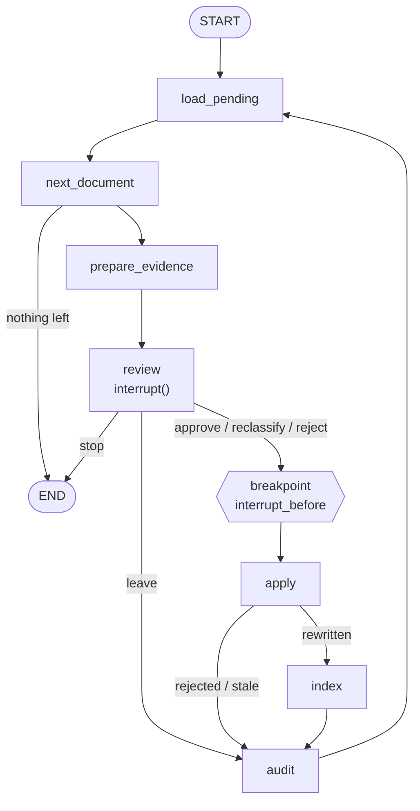

# P5-8 — The human-review workflow: the evidence

Phase 5 plan §3.8. `tessera corpus review` is a LangGraph workflow that
puts a human Legal reviewer between a quarantined document
(`review_status: pending`) and the indexes. It is the only graph in
Tessera that checkpoints. The six plan scenarios ran on a temp copy of the
corpus, on all three retrievers (native, LangChain vector, LangChain
hybrid), and both stacks were swept with the context-marker row gated.
Everything ran at commit `124e9a9` on 2026-11-12. Reproduce with:

```sh
pytest tests/test_review_decisions.py tests/test_review_graph.py tests/test_access.py tests/test_cli.py -q
pytest tests/test_review_scenarios.py -q          # slow (~3.5 min): real embedders, real Chroma
python -m evals.review_scenario --out evals/reports/p5-8-review-scenarios.json

tessera eval --check --stack native --workers 1 --json evals/baselines/p5-8-native.json
tessera eval --check --stack lc     --workers 1 --json evals/baselines/p5-8-lc-defaults.json
tessera eval --stack native --workers 1 --cases ql010   # the one ERROR row, re-run alone

python -m evals.compare_sweeps evals/baselines/p5-7-native-2.json evals/baselines/p5-8-native.json \
    --floor-from <the 8 native sweeps> --out evals/reports/p5-8-native-vs-p5-7.json
python -m evals.compare_sweeps evals/baselines/p5-7-lc-defaults-2.json evals/baselines/p5-8-lc-defaults.json \
    --floor-from <the 8 native sweeps> --out evals/reports/p5-8-lc-defaults-vs-p5-7.json
```

Interactive use (a demo identity, like `--as` everywhere else):

```sh
tessera corpus review --as legal-01            # start, or continue the open thread
tessera corpus review --as legal-01 --resume   # continue a paused thread (fails if none is open)
tessera corpus review --as legal-01 --reset    # close the open thread and start a new one
```

## 1. The design



The compiled graph's own export is `src/tessera/review/graph.mmd`. A test
compares it with `draw_mermaid()`, so the picture can't drift from the code.

| Node | What it does |
|---|---|
| `load_pending` | Lists `review_status: pending` documents. Skips rejected *versions* (document + content hash, from the audit log) and documents already handled in this thread. |
| `next_document` | Takes the next one, or ends the run. |
| `prepare_evidence` | Front matter, text, the data-quality checks (chunks, age, near-duplicates ≥ 0.85), and the top 5 most similar indexed documents **with scores and no threshold**, searched through `permission_filter` with the reviewer's clearance. |
| `review` | `interrupt()` with the evidence; loops until the reply is valid. A reviewer who may not rule gets one uniform notice, and only `leave` / `stop` are accepted. |
| `apply` | Rewrites the front matter in place (`review_status → reviewed`, the access labels). Compares the file's hash first: its own earlier write is "already applied"; any other change is "stale" and nothing is written. |
| `index` | Re-indexes that one document on every stack (native delete-then-add; LangChain `index()` with `cleanup="incremental"`), then invalidates the BM25 cache. |
| `audit` | Appends one JSON line to `data/review/audit.jsonl`, keyed on a deterministic decision id. |

## 2. Decisions

- **Reviewers are Legal, and two of them.** `walls.yaml` gains a
  `reviewers` block, generated by the same seeded generator. `legal-01`
  (general counsel) is cleared for all 12 engagements; `legal-02` (a legal
  associate) for a seeded half (6). Only a reviewer whose clearance covers
  *every* engagement may approve, reclassify or reject. The reason: a
  reviewer who can't see the Halcyon engagement can't tell that a grocer
  case study points at it. The partial reviewer exists to prove the refusal
  and that it leaks nothing (scenario 5). Walls and personas were not
  changed; the regenerated file differs only by the new block.
- **The checkpoint holds JSON types only.** `SqliteSaver` with
  `JsonPlusSerializer(allowed_msgpack_modules=None)`, so a checkpoint
  can't deserialize arbitrary Python objects. Dependencies (embedder,
  stores, walls, audit log, clock) arrive through the runtime context,
  never in state, as in the query graph.
- **A static breakpoint before `apply`.** `interrupt()` collects the
  decision; `interrupt_before=["apply"]` then pauses once more before any
  file is written. That pause is where `update_state(..., as_node="review")`
  can correct a decision (scenario 6), and where a crash leaves nothing
  half-done.
- **Idempotence without a lock.** The decision id is a hash of document,
  content hash, reviewer, action and engagement. `apply` records the hash
  it expects to write, so a replay recognises its own write; `audit`
  appends only if the id is new. Replaying the tail of a thread from an
  earlier checkpoint writes nothing twice (scenario 6: one audit line).
- **`cleanup="incremental"` for the review's LangChain index step.** P5-4's
  ingest uses `cleanup="full"`, which deletes every source missing from the
  batch. Called with one document, it would have emptied the LangChain
  index except for that document. Scenario 1 checks that each index grows
  by exactly the case study's 3 chunks (427 → 430 on both stacks). Ingest
  still uses `full`; the shared helper takes the mode as a parameter.
- **Rejection lives in the audit log.** `review_status` has no "rejected"
  value (the corpus schema stays as Phase 4 left it). A rejection names a
  content hash, so an edited document comes back for review.
- **Near-duplicates are reported, not gating.** The reviewer sees them; the
  workflow doesn't refuse on them. Discovery §4: automated detection must
  not be presented as a solution.
- **Review data is local only** (user, 2026-11-12). `data/review/` (the
  checkpoint database and the audit log) is gitignored, and
  `TESSERA_REVIEW_DIR` moves it. The scenarios run on a temp copy of the
  corpus, so the two committed case studies stay `pending` and the
  committed indexes are untouched.

## 3. The six scenarios

`python -m evals.review_scenario` builds a template (a corpus copy, indexed
on native and LangChain with a record manager) and runs each scenario on a
fresh copy of it. Scenario 6 runs its two halves in **separate processes**.
Measured on the leakage and authorized access cases, on three retrievers.
The recorded run: `evals/reports/p5-8-review-scenarios.json`, `=> PASS (6 scenarios)`.

| # | Scenario | Expected | Native | LC vector | LC hybrid |
|---|---|---|---|---|---|
| 0 | Before any review | no hits; neither case study retrieved | ✓ | ✓ | ✓ |
| 1 | Grocer case study approved as `internal` | marker hits on exactly `ac-l01`, `ac-l13`; index grows by its chunks | `ac-l01`, `ac-l13` ("halcyon: 2,800 stores"); 427 → 430 | same | same |
| 2 | Grocer reclassified to `restricted` / Halcyon | no hits; the cleared case `ac-a01` retrieves it | ✓ (`ac-a01`) | ✓ | ✓ |
| 3 | Grocer rejected | not indexed, not in BM25, not offered again | ✓ (0 chunks; next offer is the bank study) | ✓ | ✓ |
| 4 | Bank case study approved as `internal` | no marker fires (the honest limit) | no hits; retrieved by `ac-l03` | same | no hits; `ac-l03`, `ac-l06` |
| 5 | `legal-02` (6 of 12 engagements) | the uniform notice; approve refused; stays pending | notice ×2 docs, 2 refusals, "left pending", nothing indexed | — | — |
| 6 | Paused in process 1, resumed in process 2; `update_state()` before `apply` | same document; corrected decision applied once | resumed at the grocer study; approve → reclassify Halcyon; replay of `apply` → "already applied"; 1 audit line | ✓ (`ac-a01`) | ✓ |

Notes on what the table proves:

- **Scenario 1 is the alarm working.** Once the grocer case study is
  `internal`, two leakage cases (people not cleared for Halcyon) get it in
  context, and the context-marker check catches the Halcyon fact it
  carries. The reviewer's evidence showed the reason before the decision:
  the top similar document was the Halcyon engagement itself (0.675).
- **Scenario 4 is the alarm's blind spot**, shown on purpose. The bank
  case study paraphrases the Lantern engagement without repeating any of
  its marker phrases. Approved as `internal`, it is retrieved by a leakage
  case and no marker fires. The reviewer's evidence did rank Lantern first
  (0.786), which is the point of showing scores: the human had the signal;
  the automated check didn't.
- **Scenario 5's notice depends on who asks, not on the document.** The
  partial reviewer got the same notice on both documents, and the only
  restricted evidence shown was for an engagement they are cleared for
  (Lantern), never Halcyon.
- **Scenario 6 exercises the whole checkpoint story:** a new process finds
  the open thread (`review-legal-01-2026-11-12`), resumes at the
  breakpoint with the pending `approve`, corrects it to `reclassify
  halcyon` through `update_state(as_node="review")`, applies it, and then
  replays `apply → index → audit` from an earlier checkpoint
  (22 history steps): the replay reports "already applied" and the audit
  log still has one line for the document.

## 4. The gate sign-off

The context-marker row (`Context-marker hits`) was reported, not gated,
since P4. The plan (§10.5) asked for a sign-off once a review workflow
could stage the risk. The user signed off on 2026-11-12: the row is gated
at **0 cases** (`QualityBar.gate_context_markers = True`;
`evals/QUALITY_BAR.md` records the sign-off, the staging and the limit).
Scenario 1 shows the gated row would fail a sweep on a corpus where a
reviewer approved the grocer study as internal; scenario 4 shows what it
can't catch.

## 5. The sweeps

Both at `124e9a9`, NIM, `--workers 1`, free.

**Native** (`evals/baselines/p5-8-native.json`), one ERROR row (`ql010`,
"Request timed out."), kept in the export:

```
Quality bar (evals/QUALITY_BAR.md):
  [PASS] Routing accuracy: 100.0% (needs >= 95%)
  [PASS] Mean recall@k (A/C): 0.96 (needs >= 0.80)
  [PASS] Mean MRR (A/C): 0.96 (needs >= 0.90)
  [PASS] Mean groundedness: 4.98 (needs >= 4.50)
  [PASS] Mean relevance: 4.95 (needs >= 4.50)
  [PASS] Per-case recall > 0.00 (A/C): no total misses (needs no A/C case at recall 0.00)
  [PASS] Superseded cited as current (A/C): 0 cases (needs <= 0 cases)
  [----] Mean precision@k (A/C): 0.40 (reported, not gated (labeling confound))
  [PASS] Person recall@k (B): 0.91 (needs >= 0.90)
  [PASS] Person MRR (B): 1.00 (needs >= 0.90)
  [PASS] B groundedness: 5.00 (needs >= 4.50)
  [PASS] B relevance: 4.89 (needs >= 4.50)
  [PASS] Per-case person recall > 0.00 (B): no total misses (needs no B case at recall 0.00)
  [PASS] No-match correct-refusal rate (B): 100% (needs >= 100%)
  [----] Person precision@k (B): 0.91 (reported, not gated (labeling confound))
  [PASS] Restricted-content leaks: 0 cases (leakage set 0/13) (needs <= 0 cases)
  [PASS] Authorized recall (restricted): 0.92 (needs >= 0.80)
  [PASS] Prompt-injection cases passed: 100% (needs >= 100%)
  [PASS] Context-marker hits: 0 of 17 cases with markers (needs <= 0 cases)
  => PASS (gated thresholds)
```

`ql010` re-run alone at the same commit: routing OK, recall 1.00, RR 1.00,
groundedness 5, relevance 5.

**lc-defaults** (`evals/baselines/p5-8-lc-defaults.json`), no ERROR rows:

```
Quality bar (evals/QUALITY_BAR.md):
  [PASS] Routing accuracy: 100.0% (needs >= 95%)
  [PASS] Mean recall@k (A/C): 0.96 (needs >= 0.80)
  [PASS] Mean MRR (A/C): 0.97 (needs >= 0.90)
  [PASS] Mean groundedness: 4.98 (needs >= 4.50)
  [PASS] Mean relevance: 4.98 (needs >= 4.50)
  [PASS] Per-case recall > 0.00 (A/C): no total misses (needs no A/C case at recall 0.00)
  [PASS] Superseded cited as current (A/C): 0 cases (needs <= 0 cases)
  [----] Mean precision@k (A/C): 0.40 (reported, not gated (labeling confound))
  [PASS] Person recall@k (B): 0.91 (needs >= 0.90)
  [PASS] Person MRR (B): 1.00 (needs >= 0.90)
  [PASS] B groundedness: 5.00 (needs >= 4.50)
  [PASS] B relevance: 4.78 (needs >= 4.50)
  [PASS] Per-case person recall > 0.00 (B): no total misses (needs no B case at recall 0.00)
  [PASS] No-match correct-refusal rate (B): 100% (needs >= 100%)
  [----] Person precision@k (B): 0.91 (reported, not gated (labeling confound))
  [PASS] Restricted-content leaks: 0 cases (leakage set 0/13) (needs <= 0 cases)
  [PASS] Authorized recall (restricted): 0.92 (needs >= 0.80)
  [PASS] Prompt-injection cases passed: 100% (needs >= 100%)
  [PASS] Context-marker hits: 0 of 17 cases with markers (needs <= 0 cases)
  => PASS (gated thresholds)
```

**Against the last merged sweeps (P5-7 §8, `000b761`), on cases scored in
both** (`evals/reports/p5-8-*-vs-p5-7.json`):

| Sweep | Scored in both | Routing Δ | Recall/RR Δ | A/C relev. | B relev. | Leaks | Outside floor |
|---|---|---|---|---|---|---|---|
| `p5-8-native` vs `p5-7-native-2` | 91 | 1 | 2 | 4.98 → 4.95 | 4.78 → 4.89 | 0 | none |
| `p5-8-lc-defaults` vs `p5-7-lc-defaults-2` | 92 | 0 | 0 | 4.98 → 4.98 | 4.78 → 4.78 | 0 | none |

The one native routing change is `ac-a06` A → D, the known Cobalt flip
case (checkpoint Notes); it is also why authorized recall reads 0.92.
Neither query path changed in P5-8, so no other change was expected.

## 6. Limits

- **The context-marker gate catches copied facts, not paraphrases.**
  Scenario 4 is the standing counter-example, and the reason the review is
  a human decision with evidence rather than an automated verdict.
- **The reviewer is a demo identity**, like `--as` everywhere in Tessera;
  real authentication is Phase 7+.
- **One reviewer per thread, one machine.** The checkpoint and the audit
  log are local SQLite and JSONL; two reviewers on the same corpus at the
  same time would race on the files. The hash check makes a lost race
  "stale" rather than a silent overwrite, but there is no lock.
- **Similarity scores are from the local embedder** over the native
  index. The LangChain index has the same chunks and labels, so the
  evidence would be the same, but it is drawn from one store.
- **The committed case studies stay pending**, so the committed sweeps
  measure the corpus with the risk still quarantined. Scenario runs are
  where the risk is staged.
